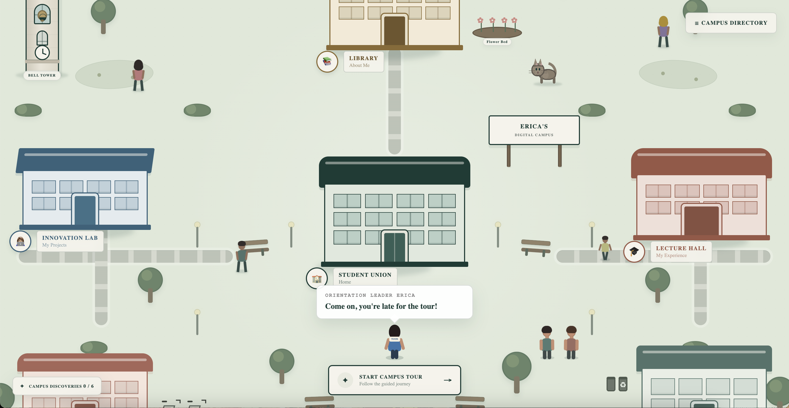

# Campus Portfolio 👩🏽‍💻

### Campus Overview

### Campus Tour Feature (led by Orientation Leader Erica)

The guided tour introduces visitors to the campus and helps them discover the different portfolio sections.

### Campus Discoveries Feature (hint: there's 6 in total!)

  An interactive portfolio website built around a virtual campus. Each area of the campus represents a different part of my portfolio, making it possible to explore my work, experience, education, and more 
in a less traditional way.

## Features

- **Interactive Campus Navigation** — Explore the portfolio through a virtual campus rather than a traditional navigation menu.
- **Guided Campus Tour** — Follow an orientation leader-led tour to discover different areas of the site.
- **Library** — Learn about my background, education, skills, and technologies.
- **Lecture Hall** — Explore my professional experience.
- **Innovation Lab** — Browse my projects and portfolio work.
- **Food Canteen** — Find contact information and ways to connect.
- **The Dorms** — Discover my hobbies, interests, and life beyond work.
- **Interactive Elements and Animations** — Engage with dynamic UI elements throughout the experience.
- **Responsive Design** — Navigate the portfolio across different screen sizes.
- **External Links** — Access projects, professional profiles, and additional resources.

## Built With

- **HTML** — Page structure and content
- **CSS** — Styling, layouts, animations, and responsive design
- **JavaScript** — Interactive components and campus navigation
- **Git & GitHub** — Version control and deployment through GitHub Pages

## Project Structure

The project is organized into reusable components, structured content, and separate stylesheets to keep the code maintainable.

- `src/components/` — Reusable UI components and campus navigation elements
- `src/data/` — Campus locations and project information
- `src/sections/` — Content for individual portfolio sections
- `src/styles/` — Styles organized by campus areas and portfolio sections
- `src/main.js` — Application entry point
- `src/styles/` — contains CSS files organized by campus areas and portfolio sections.
- `public/resume.pdf` — Downloadable resume

## Design Approach

The goal of this project was to present my background and work in a way that feels more engaging than a conventional portfolio. I used a virtual campus as the primary navigation system, connecting familiar campus spaces with different aspects of my professional and personal identity.  

The project emphasizes reusable components and interactive navigation to create an experience that is distinctive while remaining easy to explore.

## Live Website

**[Explore the Live Campus Portfolio →](https://ericaocbu.github.io/campus-portfolio/)**
